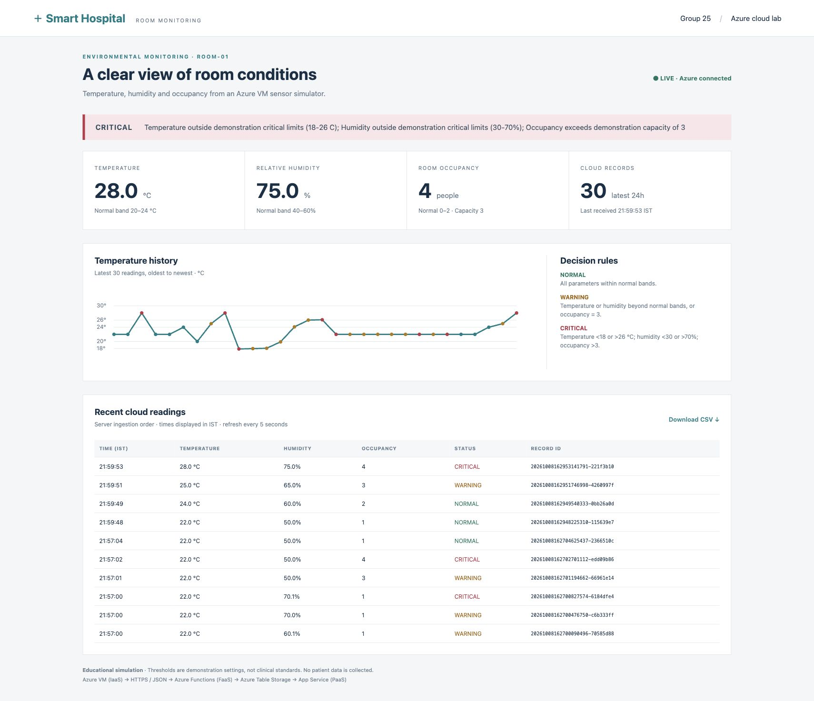

# Smart Hospital Room Monitoring

**An Azure IoT and cloud computing prototype for simulated hospital room conditions.**

A Python simulator on an Azure virtual machine sends temperature, relative humidity and occupancy readings to an HTTP Azure Function. The Function validates each reading, assigns **NORMAL**, **WARNING** or **CRITICAL**, and saves it in Azure Table Storage. A Flask dashboard on Azure App Service shows the latest status, reasons, history and CSV export.

> This is an educational simulation. It uses no physical sensors or patient data, and its thresholds are not clinical standards.

## Architecture

~~~mermaid
flowchart LR
    VM["Azure VM Python sensor simulator IaaS"] -->|HTTPS POST + JSON| FN["Azure Functions Validate and classify FaaS"]
    FN -->|Write entity| TABLE["Azure Table Storage HospitalRoomReadings"]
    TABLE -->|Server-side query| WEB["Azure App Service Flask dashboard PaaS"]
    WEB -->|HTML + read-only API| USER["Browser"]
~~~

The Function returns success only after the table write succeeds. A server-generated **RowKey** lets you trace one reading from the terminal response to the stored entity and dashboard.

## What the prototype includes

| Capability | Implementation |
| --- | --- |
| Three simulated parameters | Temperature in °C, humidity in %, occupancy count |
| Repeatable demonstrations | Normal, boundary, warning, critical, recovery, cycle and random modes |
| Input checks | Numeric ranges, integer occupancy, room ID and timezone-aware timestamp |
| Alert priority | Any critical condition overrides warnings |
| Cloud history | Raw values, sensor time, cloud receipt time, status and alert explanation |
| Dashboard | Current condition, recent table, temperature trend, 5-second refresh and CSV |
| Verification | Unit tests plus 28 cloud cases, including exact record-ID checks |

## Repository map

~~~text
source/
  simulator/        VM sensor generator and dependencies
  function/         HTTP Function, validation and classification
  dashboard/        Flask application, HTML, CSS and startup script
scripts/            Start and stop the demo VM
tests/              Rules tests and VM-to-dashboard integration runner
evidence/           Azure screenshots, synthetic test results and logs
DEMO_AND_VIVA.md    Presentation walkthrough and likely questions
SIMULATOR_CODE_GUIDE.md
README.md
~~~

The PDF report and PowerPoint presentation are intentionally excluded from this GitHub package.

## Demonstration thresholds

| Status | Temperature | Humidity | Occupancy |
| --- | --- | --- | --- |
| NORMAL | 20–24°C inclusive | 40–60% inclusive | 0–2 |
| WARNING | 18–<20°C or >24–26°C | 30–<40% or >60–70% | 3 |
| CRITICAL | Below 18°C or above 26°C | Below 30% or above 70% | Above 3 |

If several parameters are abnormal, the highest severity wins. A valid critical reading returns **HTTP 200** when it is stored successfully; CRITICAL describes the room, not an HTTP failure.

## Run the existing Azure demo

You need access to the project subscription, Azure CLI signed in to **Azure for Students**, and your SSH private key at **~/Downloads/smart-hospital-key.pem**. The VM and Azure services must already exist. The start script uses the current VM public IP, so it also works if that address changes.

~~~bash
bash scripts/start-demo.sh
~~~

This starts **hospital-room-vm**, connects over SSH and sends 60 readings at five-second intervals. Open the [live dashboard](https://smartroom-dashboard-girish2517-e6f0bacpgwc8fqhy.centralindia-01.azurewebsites.net/) beside the terminal. When the VM is off or no readings arrive for 30 seconds, the dashboard marks the feed **STALE**.

For a shorter controlled run, SSH into the VM, change to **~/smart-hospital-simulator**, load the private environment, and run:

~~~bash
. ./.env
.venv/bin/python sensor_simulator.py --scenario cycle --count 10 --interval 5
~~~

Cycle mode sends normal → boundary → warning → critical → recovery, then repeats. Use **--scenario critical --count 6 --interval 5** to hold an alert on screen. The dashboard polls every five seconds.

When finished:

~~~bash
bash scripts/stop-demo.sh
~~~

The stop script deallocates VM compute. The disk, public IP, storage and paid App Service plan may still incur charges. The app and stored data remain available between VM demonstrations.

## Function request and result

The Function accepts **POST /api/ingest** with a Function key in the **x-functions-key** header and JSON such as:

~~~json
{
  "room_id": "ROOM-01",
  "timestamp_utc": "2026-10-09T10:00:00+00:00",
  "temperature_c": 28,
  "humidity_percent": 75,
  "occupancy": 4
}
~~~

This example produces **CRITICAL** because all three readings cross demonstration critical limits. A successful response includes **success: true**, **stored: true**, the status, alert explanation and saved entity with its RowKey. Invalid input returns HTTP 400; an absent Function key returns HTTP 401; a storage failure returns HTTP 503 without claiming the reading was stored.

## Test the project

The classification tests run locally with Python 3.12 and require no Azure credentials:

~~~bash
python3 -m unittest discover -s tests -v
~~~

The cloud integration runner is intended to run inside the Azure VM after loading its environment:

~~~bash
. ./.env
.venv/bin/python cloud_e2e.py
~~~

It sends 22 accepted readings, verifies each exact RowKey through the deployed dashboard API, then checks five invalid requests and one missing-key request. The captured assessment run passed **28/28 cases**; see [recorded results](evidence/cloud-test-results.json) and [test evidence](evidence/10-test-results.jpg). Running it again creates new synthetic table records.

## Azure resources

| Layer | Deployed resource |
| --- | --- |
| Resource group | SmartHospital-IoT-RG, Central India |
| IaaS simulator | hospital-room-vm, Ubuntu 24.04 / Python 3.12 |
| FaaS ingestion | smartroom-fn-girish2517, Python Azure Functions |
| Sensor storage | smartroomgs2517 / HospitalRoomReadings |
| PaaS dashboard | smartroom-dashboard-girish2517, Flask on App Service |
| Function runtime storage | smarthospitaliotrgbf75 |

The VM also has a disk, network interface, public IP, virtual network, network security group and SSH public-key resource. These support the simulator; they are not additional sensor-processing stages. Application Insights records Function telemetry. Resource screenshots are in [evidence](evidence/).

## Configuration and deployment notes

The VM uses private **FUNCTION_URL** and **FUNCTION_KEY** environment variables. The Function and dashboard use **TABLE_STORAGE_CONNECTION_STRING** in Azure application settings. Never commit the values, the VM private key, a **.env** file or a Function local settings file.

The checked-in source is organized by deployment target. The Function project lives in **source/function**. The App Service website lives in **source/dashboard**. Its startup script loads Linux-built dependencies from a packaged **.deps** directory before starting Gunicorn. A copy-only web deployment without those dependencies cannot import the Azure Tables SDK. The simulator and cloud runner live on the VM. This repository is a source and evidence package for the existing deployment; it does not contain infrastructure-as-code to recreate the Azure resources automatically.

## Limits and responsible use

This prototype covers one simulated room. It has no calibrated sensors, patient data, authenticated dashboard viewers, durable offline queue, duplicate protection, alarm acknowledgement or automated HVAC control. Shared Function and storage credentials are suitable only for this classroom demonstration. A real hospital deployment would need approved thresholds, device identities, access control and operational review.

**Group 25:** Girish Sharma, Sanika Raut and Devansh Singh. Built for Fundamentals of IoT and Cloud Computing CA3, October 2026.
